<a href="https://github.com/nqedgelab" id="nqlab-top">
  <picture>
    <source media="(prefers-color-scheme: dark)" srcset="./assets/banner-dark.svg" />
    <source media="(prefers-color-scheme: light)" srcset="./assets/banner-light.svg" />
    
  </picture>
</a>

 

  
  
  
  
  
  <!-- Enable once nq-research is public:
  
  -->

## Hi, welcome to NQ Lab 👋

This is an open research notebook on Nasdaq-100 E-mini (NQ) futures. The question I'm working on is simple to ask and hard to answer: is there a trading edge here that holds up after costs, on data it wasn't fitted to?

I don't have that answer yet, and I'd rather show the work than claim one. Everything is paper traded, and nothing here is financial advice.

## How the research works

1. Each idea is written down as a hypothesis before it's tested, including what result would prove it wrong.
2. It's backtested with realistic costs, and judged on data held back from the start.
3. Ideas that survive get paper traded, so the backtest can be compared against live behaviour.
4. Every result gets published, including the ones that don't work. Most won't, and that's useful to know.

## Where things stand

<table>
  <tr>
    <td align="center" width="140"><h2>0</h2>Written</td>
    <td align="center" width="140"><h2>0</h2>Tested</td>
    <td align="center" width="140"><h2>0</h2>Rejected</td>
    <td align="center" width="140"><h2>0</h2>Supported</td>
    <td align="center" width="160"><h2>–</h2>Best expectancy out of sample, after costs</td>
  </tr>
</table>

**Currently testing:** nothing yet. The first hypothesis is being drafted.

## Tools

  &nbsp;&nbsp;
  &nbsp;&nbsp;
  &nbsp;&nbsp;
  &nbsp;&nbsp;
  &nbsp;&nbsp;
  

The research is done together with Claude, an AI assistant, which helps with writing hypotheses, code, and challenging the conclusions.

## Say hello

Questions, ideas to test, or reasons you think something won't work are all welcome. The easiest way to reach me is to [open an issue](https://github.com/nqedgelab/nqedgelab/issues).

  <picture>
    <source media="(prefers-color-scheme: dark)" srcset="https://streak-stats.demolab.com/?user=nqedgelab&hide_border=true&background=0F172A&ring=F59E0B&fire=F59E0B&currStreakLabel=F59E0B&sideLabels=F1F5F9&currStreakNum=F1F5F9&sideNums=F1F5F9&dates=94A3B8&stroke=334155" />
    
  </picture>

