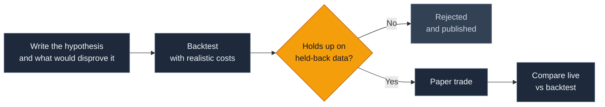

<a href="https://github.com/nqedgelab" id="nqlab-top">
  <picture>
    <source media="(prefers-color-scheme: dark)" srcset="./assets/banner-dark.svg" />
    <source media="(prefers-color-scheme: light)" srcset="./assets/banner-light.svg" />
    
  </picture>
</a>

 

  
  
  
  
  
  <!-- Enable once nq-research is public:
  
  -->

## Hi, welcome to NQ Lab 👋

This is an open research notebook on Nasdaq-100 E-mini (NQ) futures. The question I'm working on is simple to ask and hard to answer: is there a trading edge here that holds up after costs, on data it wasn't fitted to?

I don't have that answer yet, and I'd rather show the work than claim one.

> [!IMPORTANT]
> Everything here is paper traded. Nothing on this profile is financial advice.

## How the research works

Every idea goes through the same steps, and every result gets published, including the ones that don't work. Most won't, and that's useful to know.

## Where things stand

An idea only counts as an edge if its expectancy, the average result per trade measured in units of risk (R), stays positive after costs:

$$E = p \cdot \bar{W} - (1 - p) \cdot \bar{L}$$

where $p$ is the win rate, $\bar{W}$ the average win and $\bar{L}$ the average loss. A high win rate means nothing if the losses are bigger than the wins.

<table>
  <tr>
    <td align="center" width="140"><h2>0</h2>Written</td>
    <td align="center" width="140"><h2>0</h2>Tested</td>
    <td align="center" width="140"><h2>0</h2>Rejected</td>
    <td align="center" width="140"><h2>0</h2>Supported</td>
    <td align="center" width="160"><h2>–</h2>Best expectancy out of sample, after costs</td>
  </tr>
</table>

**Currently testing:** nothing yet. The first hypothesis is being drafted.

## Tools

<table>
  <tr>
    <td align="center" width="33%"> <b>Python</b> The language everything is written in</td>
    <td align="center" width="33%"> <b>pandas</b> Loading and slicing price data</td>
    <td align="center" width="33%"> <b>NumPy</b> Fast maths for backtests and statistics</td>
  </tr>
  <tr>
    <td align="center" width="33%"> <b>Jupyter</b> Notebooks for exploring results</td>
    <td align="center" width="33%"> <b>Git</b> Timestamps every hypothesis before it's tested</td>
    <td align="center" width="33%"> <b>Claude</b> AI research partner that writes code and challenges conclusions</td>
  </tr>
</table>

## Say hello

Questions, ideas to test, or reasons you think something won't work are all welcome.

> [!TIP]
> The easiest way to reach me is to [open an issue](https://github.com/nqedgelab/nqedgelab/issues). Critiques of the method are especially welcome.

  <picture>
    <source media="(prefers-color-scheme: dark)" srcset="https://streak-stats.demolab.com/?user=nqedgelab&hide_border=true&background=0F172A&ring=F59E0B&fire=F59E0B&currStreakLabel=F59E0B&sideLabels=F1F5F9&currStreakNum=F1F5F9&sideNums=F1F5F9&dates=94A3B8&stroke=334155" />
    
  </picture>

