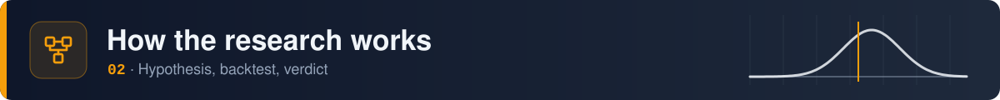
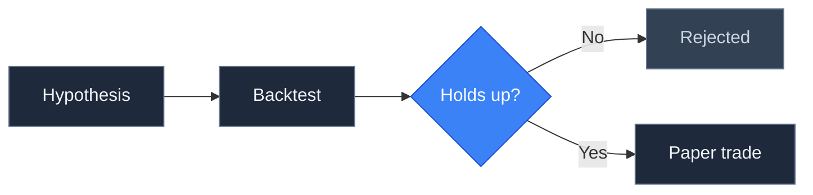
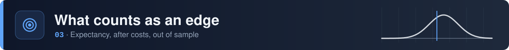
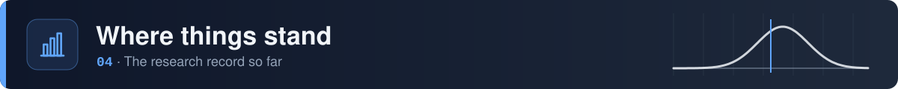
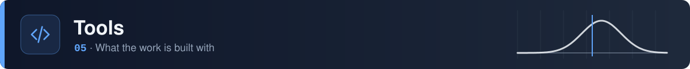
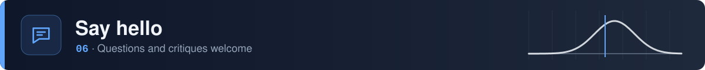

<a href="https://github.com/nqedgelab" id="nqlab-top">
  <picture>
    <source media="(prefers-color-scheme: dark)" srcset="./assets/banner-dark.svg" />
    <source media="(prefers-color-scheme: light)" srcset="./assets/banner-light.svg" />
    
  </picture>
</a>

 

  
  
  
  
  
  <!-- Enable once nq-research is public:
  
  -->

 

<picture>
  <source media="(prefers-color-scheme: dark)" srcset="./assets/section-welcome-dark.svg" />
  <source media="(prefers-color-scheme: light)" srcset="./assets/section-welcome-light.svg" />
  
</picture>

This is an open research notebook on Nasdaq-100 E-mini (NQ) futures. The question I'm working on is simple to ask and hard to answer:

<strong> is there a trading edge here that holds up after costs, on data it wasn't fitted to? </strong>

I don't have that answer yet, and I'd rather show the work than claim one.

> [!IMPORTANT]
> Everything here is paper traded. Nothing on this profile is financial advice.

 

<picture>
  <source media="(prefers-color-scheme: dark)" srcset="./assets/section-process-dark.svg" />
  <source media="(prefers-color-scheme: light)" srcset="./assets/section-process-light.svg" />
  
</picture>

Every idea is written down before it's tested, including the result that would prove it wrong. It's then backtested with realistic costs and judged on data held back from the start. Ideas that hold up get paper traded; the rest are published as rejected. Most won't hold up, and that's useful to know.

 

<picture>
  <source media="(prefers-color-scheme: dark)" srcset="./assets/section-edge-dark.svg" />
  <source media="(prefers-color-scheme: light)" srcset="./assets/section-edge-light.svg" />
  
</picture>

An idea only counts as an edge if its expectancy stays positive after costs, on data it wasn't fitted to. Expectancy is the single number every result here is judged on.

<b>What is expectancy?</b>

 

Expectancy is the average amount you make or lose per trade, over many trades. It's measured in **R**, where 1R is the amount risked on a trade (the distance from entry to stop). Measuring in R makes results comparable no matter the position size.

$$E = p \cdot \bar{W} - (1 - p) \cdot \bar{L}$$

where $p$ is the win rate, $\bar{W}$ the average win and $\bar{L}$ the average loss, both in R.

**Why win rate alone is misleading.** Two strategies, before costs:

| | Win rate | Average win | Average loss | Expectancy |
|:---|:---:|:---:|:---:|:---:|
| Strategy A | 40% | 2.0R | 1.0R | 0.4 × 2.0 − 0.6 × 1.0 = **+0.20R** |
| Strategy B | 70% | 0.5R | 1.5R | 0.7 × 0.5 − 0.3 × 1.5 = **−0.10R** |

Strategy B wins far more often and still loses money. Strategy A loses more often than it wins and still makes 0.2R per trade on average.

**Why "after costs" matters.** Commission and slippage come off every trade. A small positive expectancy can turn negative once they're included, especially with tight stops, where costs are a bigger share of 1R.

**Why sample size matters.** Expectancy from 20 trades is mostly noise. Each hypothesis here sets a minimum number of trades in advance, before any result counts.

 

<picture>
  <source media="(prefers-color-scheme: dark)" srcset="./assets/section-status-dark.svg" />
  <source media="(prefers-color-scheme: light)" srcset="./assets/section-status-light.svg" />
  
</picture>

<table>
  <tr>
    <td align="center" width="140"><h2>0</h2>Written</td>
    <td align="center" width="140"><h2>0</h2>Tested</td>
    <td align="center" width="140"><h2>0</h2>Rejected</td>
    <td align="center" width="140"><h2>0</h2>Supported</td>
    <td align="center" width="160"><h2>–</h2>Best expectancy out of sample, after costs</td>
  </tr>
</table>

**Currently testing:** nothing yet. The first hypothesis is being drafted.

 

<picture>
  <source media="(prefers-color-scheme: dark)" srcset="./assets/section-tools-dark.svg" />
  <source media="(prefers-color-scheme: light)" srcset="./assets/section-tools-light.svg" />
  
</picture>

<table>
  <tr>
    <td align="center" width="33%"> <b>Python</b> The language everything is written in</td>
    <td align="center" width="33%"> <b>pandas</b> Loading and slicing price data</td>
    <td align="center" width="33%"> <b>NumPy</b> Fast maths for backtests and statistics</td>
  </tr>
  <tr>
    <td align="center" width="33%"> <b>Jupyter</b> Notebooks for exploring results</td>
    <td align="center" width="33%"> <b>Git</b> Timestamps every hypothesis before it's tested</td>
    <td align="center" width="33%"> <b>Claude</b> AI research partner that writes code and challenges conclusions</td>
  </tr>
</table>

 

<picture>
  <source media="(prefers-color-scheme: dark)" srcset="./assets/section-hello-dark.svg" />
  <source media="(prefers-color-scheme: light)" srcset="./assets/section-hello-light.svg" />
  
</picture>

Questions, ideas to test, or reasons you think something won't work are all welcome.

> [!TIP]
> The easiest way to reach me is to [open an issue](https://github.com/nqedgelab/nqedgelab/issues). Critiques of the method are especially welcome.

  <picture>
    <source media="(prefers-color-scheme: dark)" srcset="https://streak-stats.demolab.com/?user=nqedgelab&hide_border=true&background=0F172A&ring=60A5FA&fire=60A5FA&currStreakLabel=60A5FA&sideLabels=F1F5F9&currStreakNum=F1F5F9&sideNums=F1F5F9&dates=94A3B8&stroke=334155" />
    
  </picture>

